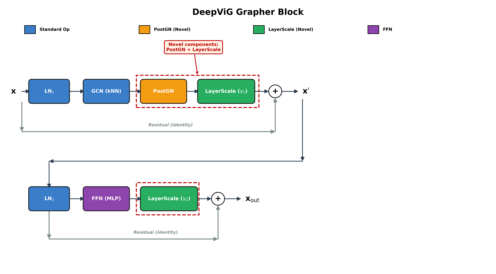

# DeepViG: Overcoming Residual Stream Instability in Vision GNNs via LayerScale and Group Normalization

<p align="center">
  
</p>

<p align="center">
  
  
  <a href="./LICENSE"></a>
</p>

**Author:** [Ranjan Kumar Sahoo](https://github.com/RKSAHOO4414)  
**Affiliation:** Alliance School of Advanced Computing, Alliance University, Bengaluru, India  
**Contact:** `ranjansahoo4414@gmail.com`

---

## Table of Contents

- [Overview](#overview)
- [Key Results](#key-results)
- [Why Standard GNN Anti-Smoothing Methods Fail in ViG](#why-standard-gnn-anti-smoothing-methods-fail-in-vig)
- [Repository Structure](#repository-structure)
- [Installation](#installation)
- [Dataset Preparation](#dataset-preparation)
- [Usage](#usage)
- [Running Phase-Specific Experiments](#running-phase-specific-experiments)
- [Experimental Results](#experimental-results)
- [Implementation Details](#implementation-details)
- [Citation](#citation)
- [Key References](#key-references)
- [Contact and Acknowledgments](#contact-and-acknowledgments)

---

## Overview

Vision Graph Neural Networks (ViGs) offer a compelling alternative to CNNs and ViTs by structuring images as graphs of visual tokens. However, standard ViG architectures cannot scale beyond **12 Grapher blocks** without significant performance degradation.

This repository contains the complete implementation and experimental code for **DeepViG**, a lightweight architectural modification that enables depth scaling in Vision GNNs. We identify the root cause of the depth bottleneck as **residual stream instability**—not classical feature homogenization—and propose two simple yet effective components:

- **Post-Graph Group Normalization (PostGN):** Stabilizes channel statistics within each node without cross-node coupling.
- **LayerScale:** Learnable per-channel trust weights that prevent deep layers from overwhelming the residual stream.

---

## Key Results

| Model | Blocks | Parameters | Top-1 Accuracy (ImageNet-100) | Δ vs. Baseline |
|:--|--:|--:|--:|--:|
| ViG-Ti Baseline | 12 | 5.87M | 57.65 ± 0.09 | – |
| DeepViG | 16 | 7.84M | 61.09 ± 0.30 | +3.44 |
| DeepViG | 20 | 9.32M | 61.63 ± 0.15 | +3.98 |
| **DeepViG** | **24** | **11.29M** | **62.54 ± 0.22** | **+4.89** |

### Highlights

- **+4.89% absolute improvement** over the 12-block baseline (statistically significant, *p* < 0.001).
- **Monotonic accuracy scaling** with depth (12 → 16 → 20 → 24 blocks).
- **Negligible overhead:** <0.2% parameters and <0.5% FLOPs.
- **Autonomous depth selection:** The network learns to dampen its deepest stage (mean γ ≈ 0.076 with 28.8% negative values).
- **Graceful robustness:** Accuracy changes from 62.6% to 44.9% under 30% input patch masking.

---

## Why Standard GNN Anti-Smoothing Methods Fail in ViG

We systematically evaluated standard GNN over-smoothing remedies and found that they **fundamentally fail** in the visual domain:

| Method | Result (16 blocks) | Reason |
|:--|:--|:--|
| **DropEdge** | 44.26% (*p* = 0.1) → 37.30% (*p* = 0.5) | Disrupts max-relative aggregation, causing discontinuous feature shocks |
| **PairNorm** | **1.64% (collapse)** | Destroys the image's DC component (brightness, hue, spatial layout) |

**Conclusion:** The ViG depth bottleneck is a residual stream instability problem, requiring a different stabilization mechanism.

---

## Repository Structure

```text
DeepVig_project/
│
├── phase_0_experiemnt/                 # Setup and baseline reproduction
│   ├── phase_0/                        # Initial codebase
│   ├── success_phase0/                 # Working baseline implementation
│   ├── phase0_experiment1-4.ipynb
│   └── phase_0.txt                     # Setup notes
│
├── phase_1_experiment/                 # Pilot: failure of standard methods
│   ├── phase1_experiment1.ipynb
│   ├── phase1_pilot_results.csv
│   ├── phase1_pilot_history.csv
│   ├── phase1_pilot_summary.png
│   └── mad_analysis(_fixed).png
│
├── phase_2a_experiment/                # Pilot: LayerScale and PostGN discovery
│   ├── phase2a_notebook_cells.py
│   ├── phase2a_results.csv
│   ├── phase2a_history.csv
│   └── phase2a_summary.png
│
├── phase_2b_experiment/                # Main experiments: 100 epochs, 3 seeds
│   ├── B1_baseline_12_s.pt             # Baseline checkpoint
│   ├── B2_postGN_LS_16_s.pt            # DeepViG, 16 blocks
│   ├── B3_postGN_LS_20_s.pt            # DeepViG, 20 blocks
│   ├── B4_postGN_LS_24_s.pt            # DeepViG, 24 blocks (champion)
│   ├── B5_LS_only_16_s.pt              # Ablation
│   └── B6_LS_1e4_20_s.pt               # Ablation
│
├── phase_2C_experiment/                # Validation: MAD and robustness
│   ├── experiment_phase2C.ipynb
│   ├── champion_mad_analysis.png
│   ├── robustness_plot.png
│   └── robustness.csv
│
├── phase_2c_2_experiment/              # Extended analysis: γ heatmaps
│   ├── phase2c_C2_gamma_heatmap.py
│   ├── gamma_heatmap.png
│   ├── gamma_distributions.png
│   ├── gamma_per_layer.png
│   └── gamma_stats.csv
│
└── README.md
```

---

## Installation

### 1. Clone the Repository

```bash
git clone https://github.com/RKSAHOO4414/DeepVig_project.git
cd DeepVig_project
```

### 2. Create and Activate a Conda Environment

```bash
conda create -n deepvig python=3.10 -y
conda activate deepvig
```

### 3. Install Dependencies

The following commands install the listed PyTorch build and project dependencies:

```bash
pip install torch torchvision --index-url https://download.pytorch.org/whl/cu118
pip install timm pytorch-geometric wandb pandas matplotlib scikit-learn
```

---

## Dataset Preparation

All experiments use **ImageNet-100**, a 100-class subset of ImageNet-1K.

### Option A: Download the Pre-processed Subset

```bash
pip install datasets
python -c "
from datasets import load_dataset
ds = load_dataset('asafaa/imagent100')
ds.save_to_disk('./data/imagenet100_hf')
"
```

### Option B: Generate ImageNet-100 from ImageNet-1K

Use the ImageNetSubsetGenerator with the official CMC class list:

```bash
git clone https://github.com/BenediktAlkin/ImageNetSubsetGenerator
cd ImageNetSubsetGenerator
python generate.py --imagenet_dir /path/to/imagenet --output_dir ./data/imagenet100
```

### Expected Dataset Directory Structure

```text
data/
└── imagenet100/
    ├── train/
    │   ├── n01440764/  ... (100 class folders)
    │   └── ...
    └── val/
        ├── n01440764/
        └── ...
```

---

## Usage

### Training DeepViG

Open `phase_2b_experiment/` and run the main experiment notebook. Alternatively, use the modular Python interface:

```python
from deepvig import DeepViG, train_model

model = DeepViG(
    num_classes=100,
    blocks=24,
    use_post_gn=True,
    use_layer_scale=True,
)

train_model(
    model,
    data_dir="./data/imagenet100",
    epochs=100,
    batch_size=128,
)
```

### Evaluating the Champion Model

```python
import torch
from deepvig import DeepViG

model = DeepViG(
    num_classes=100,
    blocks=24,
    use_post_gn=True,
    use_layer_scale=True,
)

checkpoint = torch.load(
    "phase_2b_experiment/B4_postGN_LS_24_s42_best.pt"
)
model.load_state_dict(checkpoint["model_state_dict"])
model.eval()

# Evaluate
accuracy = evaluate(model, val_loader)
print(f"Top-1 Accuracy: {accuracy:.2f}%")
```

---

## Running Phase-Specific Experiments

| Phase | Notebook / Directory | Description |
|:--|:--|:--|
| Phase 0 | `phase_0_experiemnt/phase0_experiment*.ipynb` | Baseline setup and profiling |
| Phase 1 | `phase_1_experiment/phase1_experiment1.ipynb` | DropEdge, PairNorm, k-sweep, and MAD analysis |
| Phase 2A | `phase_2a_experiment/phase2a_notebook_cells.py` | PostGN/LayerScale pilot tests |
| Phase 2B | `phase_2b_experiment/` (checkpoints + CSV) | Main 100-epoch, 3-seed experiments |
| Phase 2C | `phase_2C_experiment/experiment_phase2C.ipynb` | MAD and robustness validation |
| Phase 2C-2 | `phase_2c_2_experiment/phase2c_C2_gamma_heatmap.py` | γ heatmap and signed correction analysis |

---

## Experimental Results

### Main Results (Table I)

| Configuration | Blocks | Parameters | Top-1 Accuracy (%) | Δ |
|:--|--:|--:|--:|--:|
| ViG-Ti Baseline | 12 | 5.87M | 57.65 ± 0.09 | – |
| DeepViG | 16 | 7.84M | 61.09 ± 0.30 | +3.44 |
| DeepViG | 20 | 9.32M | 61.63 ± 0.15 | +3.98 |
| DeepViG | 24 | 11.29M | 62.54 ± 0.22 | +4.89 |

### Ablation: LayerScale vs. PostGN (Table II)

| Configuration | LayerScale | PostGN | Top-1 Accuracy (%) | Δ |
|:--|:--:|:--:|--:|--:|
| Baseline | ✗ | ✗ | 57.65 ± 0.09 | – |
| LS only | ✓ | ✗ | 60.23 ± 0.55 | +2.58 |
| DeepViG | ✓ | ✓ | 61.09 ± 0.30 | +3.44 |

### Learned γ Statistics (Table IV)

| Stage | Blocks | Mean γ | Negative γ (%) |
|--:|--:|--:|--:|
| 0 | 4 | 0.189 | 13.5% |
| 1 | 4 | 0.203 | 10.7% |
| 2 | 12 | 0.167 | 9.8% |
| 3 | 4 | 0.076 | 28.8% |

### Robustness to Irregular Inputs (Table V)

| Masking | Accuracy (%) | Accuracy Drop |
|--:|--:|--:|
| 0% | 62.60 | – |
| 10% | 58.46 | −4.14 |
| 30% | 44.90 | −17.70 |
| 50% | 30.02 | −32.58 |

---

## Implementation Details

### DeepViG Block (PyTorch)

```python
import torch
import torch.nn as nn


class DeepViGBlock(nn.Module):
    def __init__(self, channels, num_groups=8, layer_scale_init=0.01):
        super().__init__()
        self.norm1 = nn.LayerNorm(channels)
        self.gcn = MRConv2d(channels, channels)  # Max-relative graph conv
        self.post_gn = nn.GroupNorm(num_groups, channels)
        self.gamma1 = nn.Parameter(layer_scale_init * torch.ones(channels))
        self.norm2 = nn.LayerNorm(channels)
        self.ffn = nn.Sequential(
            nn.Linear(channels, channels * 4),
            nn.GELU(),
            nn.Linear(channels * 4, channels),
        )
        self.gamma2 = nn.Parameter(layer_scale_init * torch.ones(channels))

    def forward(self, x, edge_index):
        # Graph convolution branch with PostGN + LayerScale
        h = self.norm1(x)
        g = self.gcn(h, edge_index)
        a = self.post_gn(g)
        x = x + self.gamma1 * a

        # FFN branch with LayerScale
        z = self.ffn(self.norm2(x))
        x = x + self.gamma2 * z
        return x
```

---

## Citation

If you use this code or find our work helpful, please cite:

```bibtex
@article{sahoo2026deepvig,
  title   = {DeepViG: Overcoming Residual Stream Instability in Vision GNNs via LayerScale and Group Normalization},
  author  = {Sahoo, Ranjan Kumar and Charan, A Sai},
  journal = {arXiv preprint},
  year    = {2026}
}
```

---

## Key References

1. **ViG:** Han et al., “Vision GNN: An Image is Worth Graph of Nodes,” NeurIPS 2022.
2. **LayerScale:** Touvron et al., “Going Deeper with Image Transformers,” ICCV 2021.
3. **GroupNorm:** Wu and He, “Group Normalization,” ECCV 2018.
4. **DropEdge:** Rong et al., “DropEdge: Towards Deep GCNs,” ICLR 2020.
5. **PairNorm:** Zhao and Akoglu, “PairNorm: Tackling Oversmoothing in GNNs,” ICLR 2020.

---

## Contact and Acknowledgments

- **Author:** Ranjan Kumar Sahoo — `ranjansahoo4414@gmail.com`
- **Institution:** Alliance School of Advanced Computing, Alliance University, Bengaluru, India
